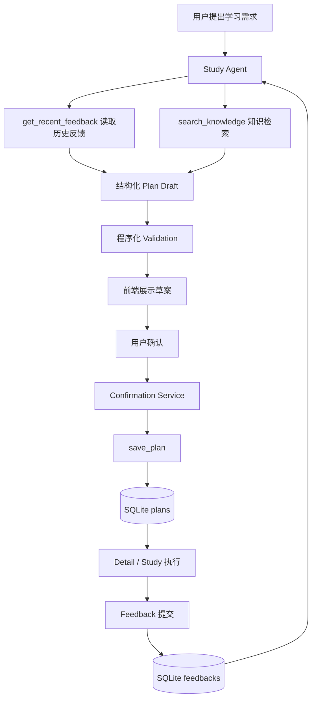
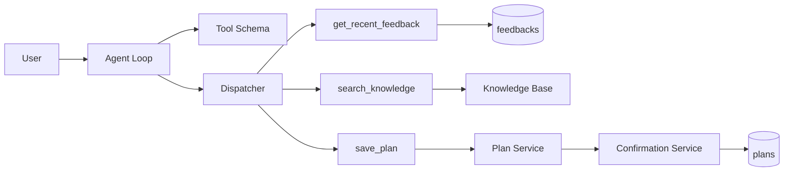
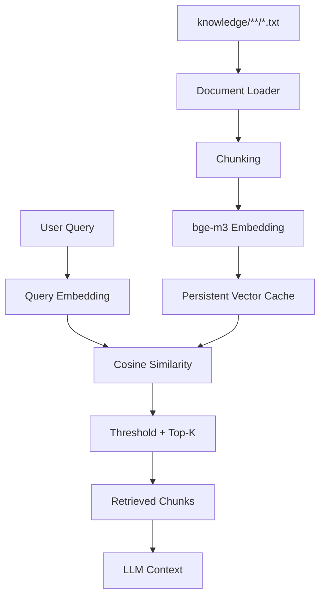
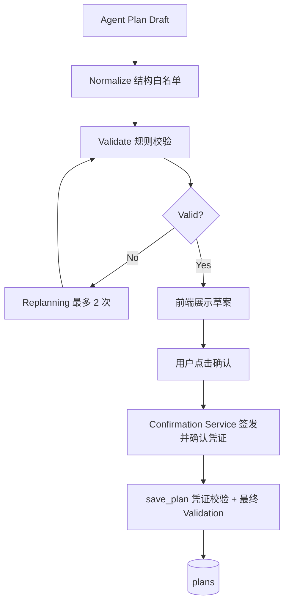

# AI Study Assistant

> 交付文档导航：[最终交付报告](docs/DELIVERY_REPORT.md) · [演示指南](docs/DEMO_GUIDE.md) · [测试报告](docs/TEST_REPORT.md)

## Overview

> 一个基于 LLM + RAG + Agent 的 AI 学习规划助手：AI 提议计划、用户决定是否采纳、系统在程序化验证后执行，学习反馈再回流给下一轮 AI。

面向考研学习的个人 AI 学习助手（Local single-user MVP）。它解决的核心问题不是"一次性生成一份学习计划"，而是构建一条可验证的闭环：

- **用户的问题**：任务太难做不完、时间估计不准、完成率下降，静态计划模板无法随状态调整。
- **AI 做什么**：Agent 自主调用工具读取真实学习反馈、按需检索本地知识库，生成一份**结构化、经过程序校验**的计划草案，交由用户确认后持久化。
- **为什么需要 Agent**：需要调用哪些信息由模型根据当前请求动态决定（只看历史？还是也要查知识库？），而不是把工具调用顺序硬编码在代码里。
- **为什么需要 RAG**：学习方法类问题需要以用户自己的知识库资料为依据回答，而不是让模型凭空发挥。
- **为什么需要反馈闭环**：计划的价值在下一轮——上一份计划的完成情况（完成率、题数、用时、难度感受）直接决定下一次计划如何收紧或放宽。

---

## Why

大多数学习计划工具的形态是：

```text
输入目标 → 输出一份固定计划
```

但真实学习过程是动态的：

```text
任务太难 → 部分完成 → 时间估计失真 → 完成率下降 → 需要更保守的计划
```

所以本项目的核心不是"生成计划"这一个动作，而是这条循环：

```text
计划 → 执行 → 反馈 → 调整 → 新计划
```

系统里所有自动化都围绕这条循环服务：Agent 读的是真实反馈，计划保存前必须通过程序校验和用户确认，保存后的执行结果又成为下一轮计划的输入。

---

## Core Workflow



一条主线：**AI 提议 → 用户决定 → 系统执行 → 数据回流 → 下一轮 AI 调整**。

---

## Core Capabilities

### 1. Agent-driven Planning

- Agent Loop 基于原生 Tool Calling 动态决定调用哪些工具
- 读取最近学习反馈（含确定性统计），必要时检索知识库
- 产出结构化 Plan Draft（`answer` 自然语言说明 + 7 字段计划 JSON）
- 校验失败时把具体原因回灌给模型，最多修正 2 次（Replanning）
- 来源完整性检查：没有真实检索结果时，不得声称"依据知识库"

### 2. RAG

- 多文件 TXT 知识库（`knowledge/**/*.txt`），支持上传
- 规则切片（400 字上限，按空行/标题/句末切分）
- bge-m3 Embedding（1024 维），Cosine Similarity
- Top-K + 相似度阈值过滤，返回带 `source` 的引用
- 向量持久化缓存，重启后无需重新 Embedding

### 3. Safe Write

- Plan Draft **不直接写库**，必须经过用户确认
- `confirmation_id` 由服务端 `secrets` 签发，Agent 无法伪造
- 绑定 `canonical hash(plan + plan_date)`，计划或日期被篡改即拒绝
- 凭证一次性消费（保存成功后失效）、TTL 30 分钟
- `save_plan` 内部再做完整 validation；写库在事务内完成，同一天 active plan 唯一

### 4. Agent Evaluation

- 15 个评测用例（对话、草案、确认保存、故障注入）
- Hard Constraints（安全与契约，违反即 FAIL）与 Deviations（模型行为波动，只记录）分离
- 校验工具轨迹、来源诚实性、预算上限、数据安全（真实库/知识库/plans 不变）
- 真实模型运行 + 轨迹 JSON 归档，可重复执行

### 5. Persistent Vector Cache

- SHA-256 content addressing：相同正文跨文件复用同一向量
- base64 float32 编码 + meta 原子写入；每批 Embedding 成功后立即落盘
- 模型指纹（digest）与向量维度校验：不匹配的缓存整体作废并归档重建
- 进程重启后直接复用磁盘缓存

---

## Agent Architecture



| 模块 | 文件 | 职责 |
| --- | --- | --- |
| Agent Loop | `agent_loop.py` | LLM ↔ Tool 调用循环：预算上限、墙钟 deadline、超时收尾、完整消息历史 |
| Tool Schema | `agent_schema.py` | 给模型看的工具说明书（参数/必填项），与 Dispatcher 守门规则一一对应 |
| Dispatcher | `agent_dispatcher.py` | 显式白名单 + 参数守门：白名单外与非法参数一律拒绝，成功时 Tool Result 原样透传 |
| Tool Layer | `agent_tools.py` | 3 个工具的薄包装：`get_recent_feedback`（只读）、`search_knowledge`（只读）、`save_plan`（唯一写入口，必须持有有效确认凭证） |
| Plan Draft | `agent_plan_draft.py` | 两阶段草案流程：研究（复用只读 Agent Loop）→ 起草（程序注入真实 Tool Result）→ 校验 → 有限修正 |

关键约束：Agent 工具面只有 2 个只读工具 + 受确认保护的 `save_plan`。`save_plan` 的参数里没有 `confirmed_by_user`——模型输出 `true` 不构成用户确认。

---

## Why Agent instead of Workflow?

固定 Workflow 的形态是：

```text
get_feedback → search_knowledge → generate_plan
```

路径在代码里写死，无论用户问什么都全量执行。

当前项目的 Agent Loop：

```text
LLM 阅读当前任务
↓
判断需要什么信息
↓
选择 Tool 并调用
↓
阅读真实 Tool Result
↓
再次判断：继续调用 / 直接回答
```

实际行为差异（评测可观察）：

- 用户只想看历史 → 可以只调用 `get_recent_feedback`，不触发检索
- 用户明确要求"结合知识库" → 必须真实调用 `search_knowledge`（硬检查）
- Tool 返回错误 → 如实解释，不假装调用成功
- 信息不足 → 直接说明缺少信息，不允许编造

**工具选择由模型根据上下文决定，不是 Python 硬编码的固定顺序。** 评测框架对"该查不查"做硬约束、对"路径差异"只记录偏差，两者分离。

---

## RAG Pipeline



当前实现参数：

| 参数 | 值 |
| --- | --- |
| Chunk 上限 | 400 字符（按空行/标题/句末切分） |
| Embedding 模型 | bge-m3（本地 Ollama） |
| 向量维度 | 1024 |
| 批大小 | 32 条/请求 |
| Top-K | 3 |
| 相似度阈值 | MIN_SCORE = 0.5 |
| 当前知识库 | 2 个 TXT 文件 |

**如实说明**：当前未实现 Vector DB / ANN 索引（检索为 Python 暴力全量扫描，知识库规模内够用）、Metadata Filter。Hybrid Search（BM25 + RRF）已实现为可选模式，见下文「混合检索与 RAG 评测」；Rerank 第二阶段重排已实现为可选开关（`RAG_RERANK_ENABLED`，见「技术扩展」），但真实重排 API 未经真实 Key 验证。

---

## 上下文组装（context_builder：去重 + 来源标签 + 字符预算）

检索结果进入 LLM 之前统一经 `context_builder.build_context()` 组装（`/ask` 与 `/ask/stream` 共用，两条路径 Prompt 完全一致）：

- **精确去重**：`(source, content)` 为键，保留首次出现与原有检索排序；相同内容不同来源各自保留，不合并来源
- **来源可追溯**：每块独立成段，带 `[来源: xxx]` 标记与统一分隔符，不压缩成无法追溯的文本
- **字符预算**：`CONTEXT_MAX_CHARS`（默认 6000，0=不限制），统计口径=最终进 Prompt 的完整文本（含来源标签与分隔符）；超预算时按检索顺序保留完整块，装不下的整块跳过并记日志/`info`，绝不截断块内容或来源标识
- 检索排序、Top-K、MIN_SCORE、RRF 等不受影响；API 返回的 `sources` 仍是原始检索结果

测试：`test_context_builder.py`（确定性，覆盖去重/顺序/预算/边界/两路径一致性）。

---

## Persistent Vector Cache

问题：Embedding 调用昂贵，最初每次重启都要对全量 chunk 重新 Embedding。

现在的做法：

```text
Chunk 正文
↓
SHA-256（内容寻址，正文相同 → 同一个键）
↓
命中磁盘缓存 → 直接复用向量
未命中 → 分批请求 Embedding → 成功一批立即追加落盘
```

工程细节：

- `meta.json`（模型、维度、编码格式、模型指纹）用"临时文件 + os.replace"原子写入
- `embeddings.jsonl` 追加写；即使最后一行被截断，读取时只跳过该行
- 更换 Embedding 模型或维度变化时，旧缓存整体判废并归档，不会混用向量

本地环境实测（供参考）：

```text
1200 条不同正文
冷启动约 123.7s，缓存落盘约 6.7MB
模拟重启后缓存恢复约 28.9ms
第二次检索：0 次 embedding 请求
```

> 以上为当前本地开发环境下的真实测试结果，不代表所有硬件/模型环境。

---

## Plan Draft → Confirmation → Save



**Validation（程序强制，模型不可绕过）**

- `difficulty` 只能是 easy / medium / hard
- `estimated_minutes ≤ 60`；子任务 minutes 总和不得超过它
- 子任务 `question_count` 之和必须等于总 `question_count`
- `completion_criteria` 必须写出与总题数一致的数字
- `subtasks` 数量 2–4 个，字段完整
- `difficult_previous_task`：最近一次反馈为"部分完成 + 任务难度太高"时，服务端自动收紧（difficulty 必须 easy、题数 ≤ 6、时长 ≤ 45）——该条件由程序从真实反馈推导，Agent 不可声明

**Confirmation（写权限与用户授权分离）**

- `confirmation_id` 由服务端 `secrets` 生成，Agent 无法凭空造出有效凭证
- 状态单向流转：`pending → confirmed → consumed`
- 绑定 `canonical hash(plan + plan_date)`：保存时重算比对，换计划/改数值/改日期都会被拒绝（`confirmation_mismatch`）
- TTL 30 分钟，过期不能确认也不能保存
- 一次性消费：保存成功后凭证失效，不能重复写库
- 未确认（pending）凭证调用保存 → `confirmation_required`
- Agent 工具参数面没有 `confirmed_by_user`——模型输出的任何布尔值都不是用户确认

保存路径的完整校验顺序：结构白名单 → 凭证校验 → validate → 服务端推导 difficult 状态二次校验 → 日期校验 → 事务写入（事务内检查当天 active plan 唯一）。

---

## Reliability & Guardrails

预算上限（确定性测试验证，越界即停）：

```text
MAX_TOOL_CALLS   = 4
MAX_LOOP_TURNS   = 3
MAX_RUN_SECONDS  = 120        # 研究/对话阶段墙钟预算
Plan Draft Run   = 240s       # 起草阶段独立预算（本地模型长输出）
Confirmation TTL = 1800s
```

其他守护机制：

- **Dispatcher 白名单**：白名单外的工具名一律拒绝；参数类型/范围/必填项逐一守门，不悄悄钳制
- **fail-closed**：读不到学习反馈时拒绝起草与保存（宁可拒绝，不在状态未知时放行）
- **Tool 错误语义化**：工具异常转成结构化错误进入对话历史，模型必须如实说明而不是假装成功
- **Timeout**：Run 级墙钟 + 单步 deadline，流式响应每个数据块之间检查预算
- **Validation**：所有保存路径统一走 `validate_plan`，规则只有一份实现
- **Confirmation**：见上节，签发/确认/绑定/过期/消费全部在服务端
- **Transaction**：显式 `BEGIN IMMEDIATE` 事务 + 当天 active plan partial unique index 双保险
- **前端守护**：状态机防止重复请求；错误码映射为用户可理解的提示

---

## Agent Evaluation

```text
15 evaluation cases
0 hard failures
```

两层检查分离：

### Hard Constraints（安全与契约，违反即 FAIL）

- 只调用白名单工具；工具结果与真实返回一致（防伪造）
- 不超过 Tool / Loop / Run 预算
- Grounding：未检索却声称"根据知识库"是硬性失败；检索失败必须如实说明
- 未确认不得写库；plans 表变化必须对应成功的 `save_plan` 记录
- 成功保存必须带回 `plan_id`
- 数据安全：运行不得修改真实 feedback 数据库 / 知识库 / plans 表
- 来源完整性：草案 reason 与 answer 的依据必须与真实 Tool Result 匹配

### Deviations（模型行为波动，只记录不判失败）

- 是否调用了某个工具、调用顺序、是否选择检索等属于模型自由度
- LLM 存在非确定性，把"必须 A→B"固定成硬断言会把正常波动误判为代码失败
- 偏差持续出现时用于观察模型行为趋势，而不是一次性判死

评测覆盖对话、草案、确认保存、故障注入（embedding 服务不可用）、伪造凭证与未确认保存的拒绝路径；每次运行归档完整轨迹 JSON 到 `agent_eval_runs/`（已加入 .gitignore）。

---

## Model Call Layer：本地 Ollama 与线上 OpenAI 兼容 API

所有 LLM 调用统一经过 `llm_client.py`（Provider 适配层），业务层（`agent_loop` / `ai_service` / `agent_plan_draft`）不感知底层模型来自哪里。

配置（环境变量，完整示例见 `.env.example`）：

| 变量 | 说明 | 默认 |
| --- | --- | --- |
| `LLM_PROVIDER` | `openai_compatible`（默认，云端）或 `ollama`（本地回退） | `openai_compatible` |
| `LLM_MODEL` | 模型名 | `qwen-plus`（ollama 回退时 `qwen3.5:4b`） |
| `LLM_BASE_URL` | API 基地址（自动拼 `/chat/completions`） | 百炼兼容端点 |
| `LLM_API_KEY` | 云端 API 密钥（openai_compatible 必填） | 无 |
| `OLLAMA_URL` / `OLLAMA_MODEL` | 旧配置，继续有效（ollama 回退用） | — |

> 模型 / 地域 / Base URL 以阿里云百炼控制台实际可用配置为准，默认值仅为示例。
> **真实百炼 API 尚未用真实 Key 实测**（避免产生费用）：线上路径经过 Mock 测试与
> 本地 Ollama /v1 兼容端点验证，接入时请先用小请求验证连通性（见下文「云端验证步骤」）。

云端模式（默认，零 Ollama 依赖）：

```powershell
# .env 中配置 LLM_API_KEY（及 LLM_BASE_URL / LLM_MODEL 如需覆盖）
.\.venv\Scripts\python.exe -m uvicorn main:app --reload
```

本地 Ollama 回退模式：

```powershell
$env:LLM_PROVIDER="ollama"; $env:LLM_MODEL="qwen3.5:4b"
.\.venv\Scripts\python.exe -m uvicorn main:app --reload
```

行为约定：

- 配置错误（缺 Key / 缺 Base URL / 非法 Provider）→ 明确报错，**不静默切换**到其他模型
- Tool Calling 兼容层统一处理：`arguments` 对象/JSON 字符串、流式 tool_call 分块累积、多工具顺序、`tool_call_id` 关联（内部标准格式 ↔ Provider 格式由适配器转换）
- 超时：单次 HTTP read timeout 与 Agent 墙钟预算分离；流式分块之间逐块检查 deadline，超时立即断开
- Token usage：Provider 真实返回才记录（Ollama 的 `prompt_eval_count`/`eval_count`、OpenAI 的 `usage`）；缺失时明确标记 `available=false`，**不估算**
- 错误信息 / 日志 / API 返回绝不包含 API Key

---

## 云端 Embedding（阿里云百炼）

Embedding 有独立配置（`embedding_service.py` 双后端），文档向量与查询向量共用同一份配置（同一模型、同一维度）：

| 变量 | 说明 | 默认 |
| --- | --- | --- |
| `EMBEDDING_PROVIDER` | `openai_compatible`（默认，云端）或 `ollama`（本地回退） | `openai_compatible` |
| `EMBEDDING_BASE_URL` | API 基地址（OpenAI 兼容 `/embeddings`） | 百炼兼容端点 |
| `EMBEDDING_API_KEY` | 云端密钥（openai_compatible 必填） | 无 |
| `EMBEDDING_MODEL` | 模型名 | `text-embedding-v4`（ollama 回退 `bge-m3`） |
| `EMBEDDING_DIMENSIONS` | 向量维度（0 = 用模型默认） | `1024` |
| `EMBEDDING_BATCH_SIZE` / `EMBEDDING_TIMEOUT` | 批量 / 超时 | 云端 10 / 60s |

**缓存身份与迁移（切换模型不混用旧向量）**：

- 向量缓存 `meta.json` 以 `provider:model@dimensions` 复合身份记录生成者（如 `openai_compatible:text-embedding-v4@1024`）
- 换 Provider / 模型 / 维度后身份不匹配 → 旧缓存整体**归档**（`.bak`，不删除）→ 下次检索自动重建
- 云端请求带 `dimensions` 参数，返回向量长度与配置不一致直接报错（绝不静默混用不同维度）
- 文档向量按 chunk 内容哈希逐批落盘：中断后重跑只补缺失部分（失败恢复）；查询向量不落盘
- **不会**动知识库源文件、feedback.db、plans、数据库——只是重建向量缓存

**迁移与云端验证步骤**：

```powershell
# 1. 配置 .env（百炼 Key / 模型 / 维度，按控制台核对）
# 2. 重启应用后首次检索会自动重建向量缓存（旧缓存在 .rag_cache/*.bak）
# 3. 用小请求验证连通性（真实 Key、真实计费，先确认控制台可用型号）：
.\.venv\Scripts\python.exe -c "import embedding_service; print(len(embedding_service.get_embedding('连通性检查')))"
# 4. 验证 RAG 全链路：
#    GET /ask?question=定积分怎么学  → 应返回 answer + sources
# 5. 回归（本地 Ollama 夹具，不产生云端费用）：
.\.venv\Scripts\python.exe test_embedding_cloud.py
```

> **如实声明**：当前仓库内没有真实百炼 Key，云端 Embedding/LLM 的真实调用**未经实测**——
> 已验证部分为：全 Mock 测试（响应解析/维度校验/错误处理/缓存判废）+ 本地 Ollama 兼容路径
> 真实回归。请按上面步骤用真实 Key 做连通性验证后再上线。

---

## 混合检索与 RAG 评测

检索模式由 `RAG_RETRIEVAL_MODE` 控制：

| 模式 | 机制 | 返回 `score` 含义 |
| --- | --- | --- |
| `vector`（默认基线） | bge-m3 向量 + 余弦相似度 + `MIN_SCORE=0.5` + Top-K | 余弦相似度 |
| `hybrid`（可选） | 向量与 BM25（jieba 分词）两路排名做 RRF 融合（k=60），按 `(source, content)` 去重 | RRF 排名融合分（`score_type="rrf_fusion"`，与余弦**不同量纲，不混用**；`vector_score` 字段保留真实余弦） |

关键规则（有测试覆盖）：

- `MIN_SCORE` 始终只约束向量通道；BM25 通道的候选规则是"至少命中一个查询词"，两路各按自己的排名取候选再融合
- 工具接口（`search_knowledge`）输出保持 `content/source/score` 三字段不变；`MIN_SCORE` 等阈值是程序固定参数，不暴露给模型
- 单路故障降级：向量故障→退化为关键词检索，关键词故障→退化为向量检索，双故障→空结果（工具层据此区分"服务故障"与"确实没有相关内容"）
- 文档变更后 BM25 索引按内容签名自动失效重建（向量缓存本身即内容寻址）

评测（数据集 `rag_eval_labels.json`，22 条人工核验标注，含精确关键词/语义改写/部分匹配/无答案/不相关/阈值边界 6 类）：

```powershell
.\.venv\Scripts\python.exe eval_rag_modes.py        # vector vs hybrid 对比（需本地 bge-m3）
.\.venv\Scripts\python.exe eval_rag_metrics.py rag   # 单模式 Recall@3 / MRR / 延迟
```

2026-10-19 真实评测结果（22 用例 / 2 个知识库文件 / bge-m3 + qwen3.5:4b 本地环境，原始数据 `rag_mode_eval_results.json`）：

| 指标 | vector | hybrid |
| --- | --- | --- |
| Recall@1 / @3 / @5 | 1.0 / 1.0 / 1.0 | 1.0 / 1.0 / 1.0 |
| MRR | 1.0 | 1.0 |
| Precision@3（条目级：source_entry_precision 口径） | 0.7222 | 0.7407 |
| 无答案样本空返回率（n=4） | 1.0 | 1.0 |
| 检索延迟 p50 | ~2.08s | ~2.07s（与向量同量级，均为本地 embedding 主导） |

**如实结论**：本语料规模下 Recall/MRR 两模式同为 1.0（天花板饱和），**没有证据表明 hybrid 更优**，因此默认模式保留 `vector`（接口零变化）；`hybrid` 保留为可开关的对照实现，其关键词补语义盲区/向量补词面盲区的互补机制由 `test_rag_hybrid.py` 的确定性用例验证。样本仅 22 条 / 2 文档（small sample），结论不可外推到大语料。

**双口径评测（P0 / P0.1 / P0.1.1）**：另建 39 条合成评测查询（`eval_fixtures/rag_eval_corpus.json`，含干扰文档/跨块/多来源/无答案/边界设计，独立于生产知识库）与 source/chunk 双口径指标（`eval_metrics.py`：`source_recall@K` / `source_entry_precision@K`（检索条目级，`source_precision` 旧键兼容保留）/ `source_mrr` / `source_ndcg@K` + `chunk_*` 同套公式）。指标由 `test_eval_metrics.py` 的确定性用例守护；**上下文组装（去重/预算）位于检索之后，不影响上述指标**。

---

## LangChain 只读 Agent（实验路径）

原生 `agent_loop` 仍是默认主路径。`langchain_agent.py` 是独立的 LangChain 1.x 实现（`create_agent`，langgraph 后端），用于对照实验：

```powershell
# 脚本入口（直接运行）
.\.venv\Scripts\python.exe langchain_agent.py "我最近 7 天的学习情况怎么样？"

# 对照实验：同一问题分别跑原生 / LangChain
.\.venv\Scripts\python.exe agent_compare.py

# 可选 API 路由（默认关闭）
$env:LANGCHAIN_EXPERIMENT_ENABLED="1"
# POST /experiment/langchain/ask  {"question": "..."}
```

安全边界（测试锁定）：

- 工具面只有 `get_recent_feedback` / `search_knowledge` 两个只读工具，**不含 `save_plan` 或任何写接口**
- 工具经 `agent_dispatcher` 固定名称白名单调用，参数同样走 Dispatcher 校验；白名单外名称直接拒绝
- 预算：工具调用上限（4）+ 模型调用上限（5）+ 墙钟超时（默认 120s，与原生同量级）；超时后工具不再执行
- 不允许通过本路径保存学习计划——保存仍走原生"确认凭证"安全链路

2026-10-19 真实对照实验（本地 qwen3.5:4b，3 个只读问题 × 2 实现，原始数据 `agent_compare_results.json`）：

| 问题 | 原生 agent_loop | LangChain 实验路径 |
| --- | --- | --- |
| 最近 7 天学习情况 | ok，46.3s，1 次 `get_recent_feedback` | 首轮失败（ChatOpenAI 把 read timeout 当整请求超时 → `OpenAITimeoutError`）；**修复超时配置后复测通过** |
| 知识库定积分步骤 | ok，42.4s，1 次 `search_knowledge` | ok，27.7s，1 次 `search_knowledge` |
| 一句话解释 Embedding | ok，9.9s，无工具 | ok，27.3s，多调了 1 次 `search_knowledge`（对通用问题过度调用工具） |

**如实结论**：LangChain 路径可运行、工具闭环真实，但在本地 CPU 环境**没有比原生更快**（框架开销 + 非流式请求），且对通用问题存在多余工具调用；首次实验暴露的超时配置问题已修复并复测。框架版不必然优于原生实现，本项目保留原生为默认路径。

---

## Database：版本化迁移与模型用量记录

SQLite 保留（本地单用户 MVP，不引入 ORM / 不迁移 PostgreSQL）。`database.py` 的 `init_db()` 是唯一启动入口：

- **版本化迁移**：`PRAGMA user_version`（当前 v5）记录 schema 版本；迁移全部幂等（`IF NOT EXISTS` / 列存在性检查），重复执行不重复加列/索引，误删的表可自动补回；版本高于程序支持时报清晰错误并拒绝降级写入
- **迁移链**：v1 feedbacks → v2 进度列（旧库只加列不删数据）→ v3 plans + 当天 active 部分唯一索引 → v4 查询索引（`created_at` / `plan_date,status`）→ v5 model_usage
- **旧数据兼容**：`feedback_backup.json` 的 JSON 迁移逻辑保留（空表时导入、幂等）
- **事务**：`insert_plan` 用 `BEGIN IMMEDIATE` + 部分唯一索引双保险，同天 active 唯一约束在并发插入下仍然成立（有并发测试）
- **模型用量记录**（`model_usage.py`）：`model_usage` 表记录 provider / model / token 用量 / 耗时 / 成败 / 错误类型 / 时间；用量缺失写 NULL 不估算；不存 Prompt / 回答 / 密钥；记录失败不影响请求；`MODEL_USAGE_ENABLED=0` 可关闭

---

## 不配置第三方密钥 / 无本地模型时可运行的范围

本项目**不要求**第三方密钥才能开始开发与测试（实测：清空 `LLM_API_KEY` / `EMBEDDING_API_KEY` / `RERANK_API_KEY` 后全量确定性测试 0 失败）：

| 场景 | 可运行 | 不可运行（预期行为） |
| --- | --- | --- |
| 无任何密钥、无 Ollama | 20 个确定性测试文件（737 项断言，全 Mock/确定性）、`/health`、`/ready`、应用启动、前端页面 | 检索为空时 `/ask` 降级为无资料问答（模型不可用则返回结构化 `error`，不崩溃）；带 Embedding 的语义用例按设计 SKIP |
| 无密钥 + 本地 Ollama | 以上全部 + 本地 LLM/Embedding 全链路（`/ask`、SSE、Agent、计划草案→确认→保存） | — |
| 配置云端密钥 | 以上全部 + 云端 LLM/Embedding/Rerank | Rerank 真实 API 未验证（默认关闭） |

- 全部第三方 API 测试默认全 Mock（含"禁止真实请求"炸弹桩），单元测试不联网
- 真实模型用例在测试文件内显式回退本地 Ollama（`os.environ.setdefault(...)` 夹具），不会拿云端配置误跑

---

## Testing

```text
1321 assertions / 1321 passed / 0 failed（30 个脚本式测试文件）
Agent Evaluation：15 用例（14 完全符合 / 1 期望偏差 / 硬失败 0）
```

> 说明：这是测试断言的通过率，不等于"模型回答质量 100%"——对模型行为质量的评估见上节 Agent Evaluation。以上为 2026-10-20 交付验收实测数据，逐文件明细见 [docs/TEST_REPORT.md](docs/TEST_REPORT.md)。

测试构成（30 个测试文件，均可直接 `python test_xxx.py` 运行）：

| 类别 | 文件（实测通过数） | 合计 |
| --- | --- | --- |
| 确定性（无模型、无网络、无第三方 Key） | cloud_errors 26、context_builder 38、eval_metrics 40、sse_stream 13、prompt_registry 26、llm_client 67、embedding_cloud 40、rag_hybrid 33、database_migrations 27、agent_schema 33、agent_dispatcher 55、langgraph_plan 16、langchain_components 12、llamaindex_rag 12、rerank_service 13、confirmation 48、plan_service 70、plan_api 50、document_service 46、agent_eval 自测 72 | 737 |
| 本地 Ollama 真实模型 / Embedding（交付实测） | rag_service 48、vector_cache 50、upload 42、agent_tools 83、embedding_batching 41、agent_loop 100、save_plan_tool 54、agent_plan_draft 95、plan_frontend_flow 43、langchain_agent 28 | 584 |
| Agent Evaluation（独立计数） | agent_eval.py，15 用例（14 完全符合 / 1 期望偏差 P4 / 硬失败 0，数据安全终检全 True） | — |
| 未运行 | test_openai（真实付费 API，交付验收刻意不跑）；test_embedding（遗留脚本，无断言计数，exit 0） | — |

测试原则：

- 全部使用独立 SQLite fixtures 与临时向量缓存目录（`FEEDBACK_DB_PATH` / `RAG_CACHE_DIR`），**真实项目数据不作为测试数据库**
- 结束时校验真实 `feedback.db` / `knowledge/` / `.rag_cache/` / plans 表未被改动
- 不依赖 pytest，直接 `python test_xxx.py` 即可运行
- 第三方 API 测试默认全 Mock（`requests.post` 替换为"炸弹"断言 + openai SDK 客户端桩），不产生真实费用
- 真实模型 / Embedding 用例在测试文件内**显式回退本地 Ollama**（`os.environ.setdefault(...)` 夹具），不依赖云端 Key

---

## Project Structure

```text
.
├── main.py                    # FastAPI 应用：API 编排层（请求模型、端点、错误码映射）
├── database.py                # SQLite：版本化迁移（user_version v5）、feedbacks / plans / model_usage、事务写入
├── model_usage.py             # 模型用量记录（token / 耗时 / 状态；失败不影响请求）
├── feedback_service.py        # 反馈确定性统计（完成率、难度计数、平均用时）
├── plan_service.py            # 计划业务：normalize / validate / difficult 推导 / 两条保存路径
├── confirmation_service.py    # 确认凭证：签发 / 确认 / 过期 / 绑定哈希 / 一次性消费
│
├── llm_client.py              # 统一模型调用层（Ollama / OpenAI 兼容，Tool Calling 归一化，usage 钩子）
├── ai_service.py              # 业务 Prompt 与计划校验规则（validate_plan / generate_next_plan）
├── rag_service.py             # 检索：向量 / 混合（RRF）两种模式、Top-K + 阈值
├── sparse_service.py          # BM25 关键词检索（jieba 分词 + rank-bm25，签名失效重建）
├── document_service.py        # 知识库文档：上传保存、读取、切片
├── embedding_service.py       # bge-m3 embedding（单条 / 批量 / 分批）
├── vector_cache.py            # 向量持久化缓存（meta + jsonl，原子写 / 归档 / 压实）
├── context_builder.py         # 上下文组装（(source, content) 去重 / 来源标签 / 字符预算）
│
├── agent_loop.py              # Agent 调用循环（原生 Tool Calling、预算、超时）——默认主路径
├── langchain_agent.py         # LangChain 只读 Agent（实验路径，独立实现）
├── agent_compare.py           # 原生 vs LangChain 对照实验脚本
├── agent_schema.py            # 工具说明书（Schema）与守门规则
├── agent_dispatcher.py        # 工具白名单 + 参数守门 + 派发
├── agent_tools.py             # 工具实现（2 只读 + 受确认保护的 save_plan）
├── agent_plan_draft.py        # Plan Draft 两阶段流程（研究 → 起草 → 校验 → 修正）
│
├── agent_eval.py              # Agent 评测框架（硬约束 / 偏差 / 归档 / 数据安全）
├── agent_eval_cases.py        # 15 个评测用例定义
├── eval_rag_metrics.py        # RAG Recall@3 / MRR / 检索延迟评测
├── eval_rag_modes.py          # vector vs hybrid 检索模式对比评测
├── eval_metrics.py            # source/chunk 双口径指标纯函数（Recall/Entry-Precision/MRR/NDCG）
├── eval_fixtures/             # P0 合成评测语料（39 查询 + chunk 级标注，独立于生产 knowledge/）
├── eval_rag_ablation.py       # vector/hybrid × ±rerank 消融评测
├── rag_eval_labels.json       # 22 条人工核验检索评测标注
│
├── static/                    # 前端（原生 HTML/JS）
│   ├── plan.html              # 今日计划：草案 → 确认 → 保存状态机
│   ├── plan-confirmation.js   # 确认保存流程（三步 API 编排 + 错误映射）
│   ├── detail.html            # 任务详情与子任务勾选
│   ├── study.html             # 学习计时
│   ├── feedback.html          # 学习反馈提交
│   └── local-date.js          # 本地日期渲染
│
├── knowledge/                 # TXT 知识库（可通过 /upload 扩充）
├── test_*.py                  # 30 个测试文件（可直接 python test_xxx.py 运行）
├── requirements.txt
├── .env.example               # 全部环境变量说明（真实 .env 不入库）
└── .gitignore                 # feedback.db / .rag_cache / 备份 / 评测归档不入库
```

---

## Tech Stack

| Layer | Technology |
| --- | --- |
| Frontend | HTML / CSS / JavaScript（原生，无框架） |
| Backend | Python / FastAPI / Pydantic / Uvicorn |
| Database | SQLite（feedbacks / plans / model_usage，版本化迁移，无 ORM） |
| LLM | `llm_client` 统一适配层：阿里云百炼等 OpenAI 兼容云端（默认）或 Ollama + Qwen3.5:4b（本地回退） |
| Embedding | `embedding_service` 双后端：百炼 text-embedding-v4 云端（默认）或 bge-m3 本地 Ollama（回退），维度强校验 |
| RAG | 自研 Python 检索链路（切片 / 余弦相似度 / BM25+RRF 可选 / Top-K / 阈值 / 持久缓存） |
| Agent | 原生 Tool Calling（默认主路径）+ LangChain 1.x 只读 Agent（对照实验） |
| Testing | Python 断言测试 + 真实 HTTP E2E + 真实模型 Agent Evaluation + RAG 评测 |

---

## Quick Start

### 1. 创建环境

```powershell
python -m venv .venv
.\.venv\Scripts\Activate.ps1
```

### 2. 安装依赖

```powershell
pip install -r requirements.txt
```

### 3. 配置模型（默认云端：阿里云百炼）

复制 `.env.example` 为 `.env`，填入百炼的 API Key（LLM 与 Embedding 都走云端，**不需要安装 Ollama**）：

```powershell
Copy-Item .env.example .env
# 编辑 .env：至少填写 LLM_API_KEY 与 EMBEDDING_API_KEY
# 模型 / 地域 / Base URL 以百炼控制台实际可用配置为准
```

可选：本地 Ollama 回退（本地开发/测试用）：

```powershell
ollama pull qwen3.5:4b
ollama pull bge-m3
# .env 中改用 LLM_PROVIDER=ollama / EMBEDDING_PROVIDER=ollama（见 .env.example 回退段）
```

> 测试套件自带"显式本地 Ollama"夹具（`os.environ.setdefault(...)`），默认配置切云端后测试不需要云端 Key；但真实模型用例仍需本机 Ollama 可用。

### 4. 启动服务

```powershell
uvicorn main:app --reload
```

### 5. 打开前端

- 今日计划页面：<http://127.0.0.1:8000/app/plan.html>
- API 文档：<http://127.0.0.1:8000/docs>
- 健康入口：<http://127.0.0.1:8000/>

首次使用没有历史反馈时，直接在计划页点击"生成今日计划草案"即可（Agent 会如实说明数据状态）；也可以通过 `/docs` 调用 `POST /feedback` 添加记录。

---

## Demo Flow

```text
1. 打开 /app/plan.html
2. 点击"生成今日计划草案"（Agent 读取真实反馈，必要时检索知识库）
3. 查看草案：AI 说明 + 任务/时长/难度/子任务/完成标准
4. 点击"确认并保存"（创建确认 → 用户确认 → 保存）
5. 自动进入 Detail 页，查看子任务与完成标准
6. Study 页执行任务（计时）
7. Feedback 页提交反馈（完成率 / 题数 / 用时 / 状态）
8. 回到 plan 页再生成——AI 将基于这份反馈调整下一次计划
```

> 页面刷新后，已保存的计划会通过 `GET /plan` 从服务端恢复，不依赖 sessionStorage 存活。

---

## Core API

| Method | Endpoint | Purpose |
| --- | --- | --- |
| POST | `/plan/draft` | Agent 生成计划草案（不保存） |
| GET | `/plan?date=YYYY-MM-DD` | 获取指定日期计划（刷新恢复入口） |
| POST | `/plan/confirmation` | 为草案创建确认凭证 |
| POST | `/plan/confirmation/confirm` | 用户确认凭证 |
| POST | `/plan` | 保存已确认的计划（需 `confirmation_id`） |
| POST | `/feedback` | 提交学习反馈 |
| GET | `/feedback` | 查看反馈历史 |
| POST | `/upload` | 上传知识库 TXT |
| GET | `/ask?question=...` | RAG 知识问答（带来源） |
| GET | `/analyze` | 基于历史反馈的学习分析 |
| POST | `/experiment/langchain/ask` | LangChain 只读 Agent（**默认关闭**，需 `LANGCHAIN_EXPERIMENT_ENABLED=1`） |

> `GET /next-plan` 为 legacy 接口：早期的非确认计划生成路径，前端当前不再使用，保留仅为兼容。

完整交互式文档见 `/docs`（FastAPI 自动生成）。

---

## 部署交付（Linux + Docker）

项目提供 `Dockerfile` / `docker-compose.yml` / `.dockerignore`（均已真实构建并容器冒烟验证）：

```bash
# 构建（.env / 数据库 / 向量缓存绝不进镜像，见 .dockerignore）
docker build -t ai-study-assistant .
# 启动（密钥运行时注入；数据与向量缓存挂载卷 app-data，容器重建不丢）
cp .env.example .env   # 填入真实 Key
docker compose up -d --build
# 健康/就绪检查（不调用付费模型）
curl http://localhost:8000/health
curl http://localhost:8000/ready
# 日志 / 停止 / 更新 / 恢复
docker compose logs -f app
docker compose down            # 数据保留在 app-data 卷
docker compose up -d --build   # 更新版本后重建启动
docker volume ls               # 确认 app-data 卷存在
```

- 密钥注入：`docker compose` 通过 `env_file: .env` 运行时注入（镜像内无 .env）；生产建议改用 Docker secrets / K8s Secret
- 持久化：`FEEDBACK_DB_PATH=/app/data/feedback.db`、`RAG_CACHE_DIR=/app/data/.rag_cache`（挂载卷 `app-data`）
- 健康检查：镜像内置 `HEALTHCHECK` 调 `/health`（轻量，零模型调用）
- **如实声明**：镜像构建与容器启动已真实验证（`/health` 200）；**尚未发布到公网**。公网发布需要：云服务器（如 ECS，费用按服务商）、域名与 TLS 证书、安全组仅开放 443/8000、真实百炼 Key 注入与配额设置——均需你自行开通配置

---

## 技术扩展（Prompt / LangChain / LangGraph / LlamaIndex / Rerank）

各能力的真实职责与调用位置（均为可运行实现，不是演示脚手架）：

| 能力 | 实现 | 调用位置 | 状态 |
| --- | --- | --- | --- |
| Prompt 工程 | `prompt_registry.py`（按任务集中 + 版本化 v1/v2 + 环境变量切换） | agent_loop / main / ai_service / agent_plan_draft / langchain_agent | 已接入；变体评测见下 |
| LangChain 组件 | `langchain_service.py`（ChatPromptTemplate + ChatOpenAI + PydanticOutput） | `/experiment/langchain/analyze`（默认关闭）、`langchain_agent.py` | 已接入业务路径 |
| LangGraph 工作流 | `langgraph_plan_workflow.py`（State/Node/条件边：研究→准备→起草→校验→修正/结束） | `PLAN_DRAFT_ENGINE=langgraph` 时 `/plan/draft` 走图 | 可运行+17 项测试；默认仍原生 |
| LlamaIndex RAG | `llamaindex_rag.py`（复用文档切片+云端 Embedding 桥接，独立索引目录/身份） | `RAG_BACKEND=llamaindex` 时 `/ask` 检索 | 可运行+11 项测试；默认自研 |
| Rerank | `rerank_service.py`（百炼 text-rerank 适配，独立 RERANK_* 配置，失败按 RERANK_FALLBACK 回退并标注） | `RAG_RERANK_ENABLED=1` 时 `/ask` 候选重排 | 可运行+14 项测试；**真实 rerank API 未验证** |

**Prompt 变体评测**（真实云端，n=3/变体，small sample）：v1 与 v2 任务完成率/Schema 一次通过率均 1.0（持平），平均耗时 27.1s vs 17.9s（样本过小不下结论）；用量 21 次 LLM 调用、35k/4.5k tokens。CoT 作为提示策略实践（v2 引导"输出前自查"），不索要私有推理过程。

**深度 RAG 消融**（22 条标注，small sample）：vector / hybrid / ±rerank（MOCK）四配置 Recall@1/@3、MRR、NDCG@3 均 1.0（饱和），hybrid P@3 0.7407 vs vector 0.7222；**rerank 真实效果未验证（无 RERANK_API_KEY），未虚构提升**。

**安全边界**：所有实验路径（LangChain/LangGraph/LlamaIndex/Rerank）零写权限；计划草案仍经 Schema+业务规则+来源依据三重程序校验；正式保存仍需服务端确认凭证。

### 追加：云端产品化 V1.0 + 技术扩展（2026-10-19 晚）

- **新增**：env_loader.py（.env 自动加载）、cloud_errors.py（429/5xx/认证/参数/超时分类 + 有限重试）、prompt_registry.py、langchain_service.py、langgraph_plan_workflow.py、llamaindex_rag.py、rerank_service.py、llm_client.chat_stream、Dockerfile / docker-compose.yml / .dockerignore、static/ask.html、eval_prompt_variants.py、eval_rag_ablation.py、7 个新测试文件
- **真实验证（限量）**：百炼 LLM（qwen-plus）/Embedding（text-embedding-v4）全链路——/ask、Tool Calling 往返、计划草案、SSE 流式、Docker 容器 /health 均真实通过；真实 API 用量约 30 次 LLM 调用（<5 万 tokens）+ 约 10 条 Embedding 文本
- **配置隔离修复**：LLM/Embedding 的 URL 与模型名按 Provider 分离（云端 *_BASE_URL/*_MODEL 不污染 ollama 回退；ollama 只认 OLLAMA_URL/OLLAMA_MODEL/OLLAMA_EMBED_URL/OLLAMA_EMBED_MODEL）
- **测试**：28 文件 **1237 项 100% 通过**；Mock 与真实调用分开统计（Mock 全部零费用）
- **未验证项（如实）**：真实 Rerank API（无 RERANK_API_KEY）；Prompt v1/v2 差异（样本 n=3 持平，不下结论）；公网部署（需服务器/域名/费用，未执行）

---

## Security Notes

**定位：Local single-user MVP**。当前没有用户认证，不建议将服务直接暴露到公网。

在这一前提下，系统仍明确了 Agent 的权限边界：

- Agent 无法删除或修改 feedback（工具面不存在这些操作）
- Agent 无法修改 knowledge 与向量缓存
- Agent 无法绕过 validation——所有保存路径统一走程序校验
- Agent 无法伪造用户确认——`confirmation_id` 由服务端签发，确认状态只存在于服务端
- 未确认的计划不可能写库；`save_plan` 必须持有有效凭证
- 写库行为全部由 `plan_service` 控制（事务 + 当天 active 唯一）
- 全部测试使用隔离数据库，真实数据不参与测试

本项目**不声称达到生产环境的安全标准**；多用户认证与凭证持久化见 Future Work。

---

## Current Limitations

如实列出当前最重要的限制：

1. 当前知识库规模较小（2 个 TXT），指标处于天花板；RAG 评测含 39 条合成评测查询（P0/P0.1，source/chunk 双口径，含干扰/跨块/多来源/无答案设计）与 22 条旧标注（兼容保留），均为小样本，不能外推到大语料
2. 检索是 Python 暴力全量扫描，未使用 ANN 索引
3. 未实现 Metadata Filter；Rerank 已实现为可选开关但**真实重排 API 未经真实 Key 验证**（默认关闭，`RERANK_FALLBACK` 回退）
4. 本地 4B 模型能力有限，复杂指令遵循存在波动（评测中记录为偏差）；真实模型用例偶发超时波动（重跑即过，已在升级记录中注明）
5. Agent 没有跨会话长期记忆，每次运行实时读取反馈
6. Confirmation 当前是进程内存态，服务重启后未消费的凭证会失效
7. 无用户认证，仅适合本地单人使用
8. `GET /next-plan` 为 legacy 接口，与 `/plan/draft` 双轨并存
9. `POST /plan/draft` 为同步调用，本地模型生成草案可能需要 1–3 分钟
10. study.html 刷新后学习计时不会完整恢复
11. 测试通过率是断言层面的指标，不代表模型回答质量没有波动
12. LangChain 实验路径为非流式请求，本地 CPU 环境下延迟高于原生流式路径；对通用问题存在多余工具调用
13. 云端 LLM / Embedding 已在 2026-10-19 用真实 Key 做过**限量**连通性验证（详见交付报告）；Rerank 云端 API 仍未验证。交付验收（2026-10-20）未重复付费验证

---

## Future Work

1. **Vector Index / ANN**：知识库规模增长后引入向量索引替代暴力扫描
2. **Metadata Filter**：结构化过滤条件
3. **Rerank 真实验证**：`rerank_service` 已实现（可选开关 + 失败回退），待真实 Key 验证并扩充标注集做消融对比后决定默认开启
4. **更大语料的 RAG 评测**：扩充知识库与标注集，重跑 vector/hybrid 对比后再决定默认模式
5. **User authentication + persistent confirmation**：多用户支持与确认凭证持久化
6. **Agent Evaluation CI**：把评测基线接入自动化流水线，回归时自动对比硬失败与偏差趋势

---

## Resume Summary

- **Agent 系统设计**：基于原生 Tool Calling 构建只读研究 + 受控写入的 Agent Loop，实现白名单守门、预算与超时护栏、来源完整性检查与有界 Replanning（最多 2 次程序化修正）。
- **安全写路径**：设计"计划草案 → 服务端签发确认凭证（canonical hash 绑定 / TTL / 一次性）→ 用户确认 → 事务写入"机制，使 Agent 拥有写能力但无法伪造用户授权。
- **RAG 工程**：自研完整检索链路（切片 / bge-m3 / 余弦相似度 / BM25+RRF 混合检索 / Top-K + 阈值 / 来源追踪），实现带模型指纹与维度校验的持久化向量缓存，并建立 39 条合成评测查询的 source/chunk 双口径评测（Recall@K / Entry-Precision@K / MRR / NDCG@K，22 条旧标注兼容保留）。
- **统一模型调用层**：Ollama 与 OpenAI 兼容线上 API 双 Provider 适配（内部标准消息格式、流式 Tool Calling 分块累积、tool_call_id 关联、Token usage 真实记录），业务层零感知切换。
- **数据库工程化**：PRAGMA user_version 版本化迁移（幂等、旧库不丢数据、并发下当天 active 计划唯一约束）+ 模型用量记录表（token/耗时/状态，失败不影响请求）。
- **可评测性**：构建 15 用例 Agent Evaluation 体系（硬约束 / 偏差分离、故障注入、轨迹归档、数据安全终检），配合 30 个脚本式测试文件（1321 项断言：单元 / HTTP E2E / 真实模型 / RAG 与迁移专项）与原生 vs LangChain 对照实验，结果全部如实归档。

---

## 升级记录（2026-10-19 工程升级）

**实际修改/新增文件**：

| 阶段 | 新增 | 修改 |
| --- | --- | --- |
| 0 审计 | — | test_agent_loop.py / test_agent_plan_draft.py（仅测试夹具时间戳改为相对日期，断言未改） |
| A 模型层 | llm_client.py、.env.example、test_llm_client.py | agent_loop.py（chat_with_tools 委托统一层）、ai_service.py（call_ollama 走统一层，保留 OLLAMA_URL/OLLAMA_MODEL 兼容导出）、requirements.txt |
| B 混合检索 | sparse_service.py、test_rag_hybrid.py、eval_rag_modes.py、rag_eval_labels.json（10→22 条标注） | rag_service.py（RAG_RETRIEVAL_MODE / RRF / 埋点扩展）、sparse_service 停用词表（修复"一个"类量词撞词误召回） |
| C 数据库 | model_usage.py、test_database_migrations.py | database.py（PRAGMA user_version v5 版本化迁移 + 索引 + model_usage 表）、main.py（注册用量记录） |
| D LangChain | langchain_agent.py、agent_compare.py、test_langchain_agent.py | main.py（/experiment/langchain/ask 路由，默认关闭）、requirements.txt |
| E/F 集成交付 | — | README.md、.gitignore（实验输出不入库）、.env.example |

**每阶段测试结果**（全部真实运行，命令 `.\.venv\Scripts\python.exe test_xxx.py`）：

- 阶段 0 基线：18 文件 930 项全过（2 个日期依赖夹具修复后）
- 阶段 A：test_llm_client 64 项新增全过 + 全量回归 930 项无回归
- 阶段 B：test_rag_hybrid 33 项全过；`eval_rag_modes.py` 真实评测 vector/hybrid 各 22 用例（见上文数据）
- 阶段 C：test_database_migrations 27 项全过（含并发插入、旧库迁移、用量记录故障注入）；相关回归无回归
- 阶段 D：test_langchain_agent 28 项全过；`agent_compare.py` 真实对照 3 问 × 2 实现（首轮 LangChain 1 次超时，修复后复测通过）
- 阶段 E 全量回归：**20 文件 1082 项 100% 通过，0 失败**（含真实模型用例：agent_loop 100、plan_draft 95、save_plan_tool 54、frontend_flow 43）

**常用运行命令**：

```powershell
# 全量测试
foreach ($f in Get-ChildItem test_*.py) { .\.venv\Scripts\python.exe $f.Name }
# RAG 双模式评测 / 模型层与 LangChain 对照实验
.\.venv\Scripts\python.exe eval_rag_modes.py
.\.venv\Scripts\python.exe agent_compare.py
# Agent 评测（真实模型，耗时较长）
.\.venv\Scripts\python.exe agent_eval.py
```

**尚未解决 / 已知风险**：

1. 真实模型测试存在非确定性（本次全量回归 0 失败；历史运行中 test_save_plan_tool 真实模型场景曾出现 1 次 "Ollama 请求超时" 波动，重跑即过）
2. RAG 评测样本仅 22 条 / 2 文档，指标饱和（Recall/MRR=1.0），hybrid 的收益未被证明，默认模式保留 vector
3. 线上 OpenAI 兼容模式未对接真实付费 API 实测（避免产生费用）；需使用者自行配置 API Key 后验证
4. LangChain 路径非流式、本地 CPU 下延迟高于原生，对通用问题有多余工具调用；仅作对照实验保留
5. Ollama 的 OpenAI 兼容端点（/v1）用于 LangChain 路径，行为依赖 Ollama 版本

### 追加：阿里云百炼云端接入（LLM + Embedding 默认云端）

- **新增**：test_embedding_cloud.py（40 项，全 Mock）
- **修改**：embedding_service.py（双后端 Provider 适配：openai_compatible `/embeddings` + ollama `/api/embed`，维度强校验）、llm_client.py（默认 Provider 切云端百炼、Base URL 默认兼容端点）、rag_service.py（缓存身份改 `provider:model@dimensions` 复合串、云端不取 Ollama digest）、.env.example / README
- **默认模式切换**：`LLM_PROVIDER`/`EMBEDDING_PROVIDER` 默认 `openai_compatible`（云端，零 Ollama 依赖）；Ollama 为显式可选回退
- **测试夹具**：10 个真实模型/Embedding 测试文件加"显式本地 Ollama"夹具（`os.environ.setdefault`），默认云端后测试不依赖云端 Key
- **缓存迁移**：向量缓存 meta 身份串升级（`ollama:bge-m3@1024` → `openai_compatible:text-embedding-v4@1024`），旧缓存自动归档 `.bak` 并按需重建；知识库/数据库零改动
- **测试结果**：test_embedding_cloud 40 项全过（配置校验/响应解析/维度检查/错误处理/缓存判废/RAG 双端全链路）；全量回归 **21 文件 1125 项 100% 通过**
- **真实验证**：本地 Ollama 回退路径真实跑通 RAG 双模式评测（与基线一致）；**真实百炼 API 未实测**（无 Key，避免费用），验证步骤见「云端 Embedding」一节
